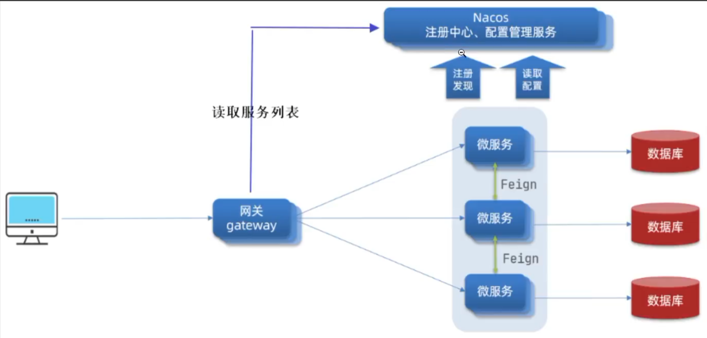

pom文件配置环境 让ai按需添加

公共模块:
```plaintext
com.eams.common 下的 api 、enums 、exception 、context 、constant

#api 放对外的数据契约（会出现在接口出参里的类）
  Result(所有接口的出参统一形状)
    - 泛型<T> ：查询课程返回 Result<CourseVO> ，删除返回 Result<Void> ，一个类适配所有接口
    - 私有构造 + 静态工厂 ：禁止外部 new Result() 乱设 code，只能走 success()/failed() ，保证响应结构永远可控
    - timestamp 赋 ：私有构造里 System.currentTimeMillis() ，每个构造链都过这里，保证一定有值
  PageResult(分页字段不放 Result 里,Result 是通用信封，分页只是 data 的一种形态。出参长这样：Result<PageResult<CourseVO>> )
    - 5 个字段：pageNum, pageSize, total, pages, list（泛型 List<T>）
    - 关键实现有一处:pages 向上取整
    
#enums 放枚举 
  ResultCode(Result、BizException、异常处理器全都依赖它)
    - 成功 → 200
    - 前端传参错了 → 400
    - 没登录 / token 过期 → 401
    - 登录了但没权限 → 403
    - 资源不存在 → 404
    - 服务器炸了 → 500
    - 业务规则不满足（余额不足、课程已下架）→ 600（自定义业务段）

#exception 放异常体系（throw / 统一捕获）
  BizException(业务异常)
    - `extends RuntimeException` 认 RuntimeException 当爹，继承它"能 throw 出去"的本事
    - 使用场景：
    - 造异常对象，当写`new BizException("余额不足")` 时，Java 就会去执行`BizException(String msg)` 这个构造方法（调构造器），把对象"初始化"好（把 code、message 填进去）。

#context 放上下文持有（贯穿一次请求的“当前用户”）

#constant 放常量（跨模块约定的字符串/数字）
  token请求头， 网关相关请求头， 用户类型（数字常量）
    - 使用场景：
    - 用类名 + 常量名来取，不用 new；
    - String header = CommonConstants.AUTH_HEADER; 就能拿到"Authorization"


Nacos，Spring Cloud Alibaba:

  #Nacos通过Spring Cloud Alibaba去代替原生Spring Cloud的Eureka组件；

  #Nacos发现微服务的地址让网关去读取（通过Spring Cloud Alibaba的Nacos发现功能实现）；

  #网关：gateway，SpringCloud的组件 负责统一入口，负责路由、负载均衡、安全等任务
    - 路由：根据请求路径、参数、头信息等将请求分发到不同的微服务
    - 路由策略：根据微服务的负载、流量、响应时间等动态调整路由规则
    - 负载均衡：将请求均匀分布到多个微服务实例上，避免单点故障
    - 安全：对请求进行认证、授权、加密等安全操作
  ；

  #Spring Cloud Alibaba用sentinel（流量控制、熔断、降级等）处理容错比如雪崩。用skywalking实现链路追踪，处理排错。


