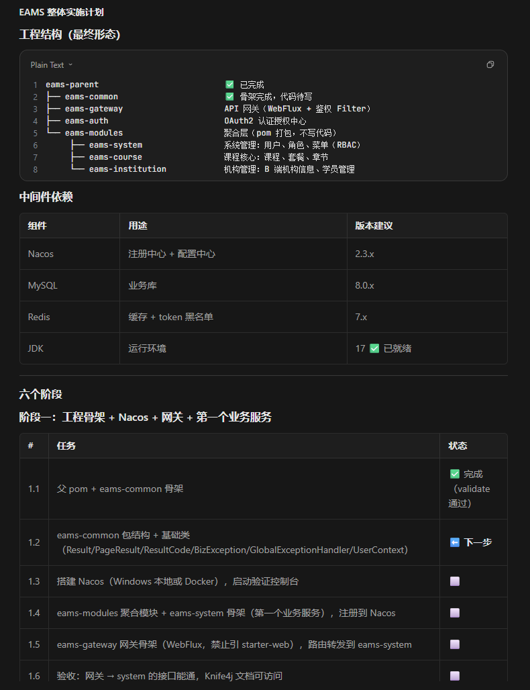
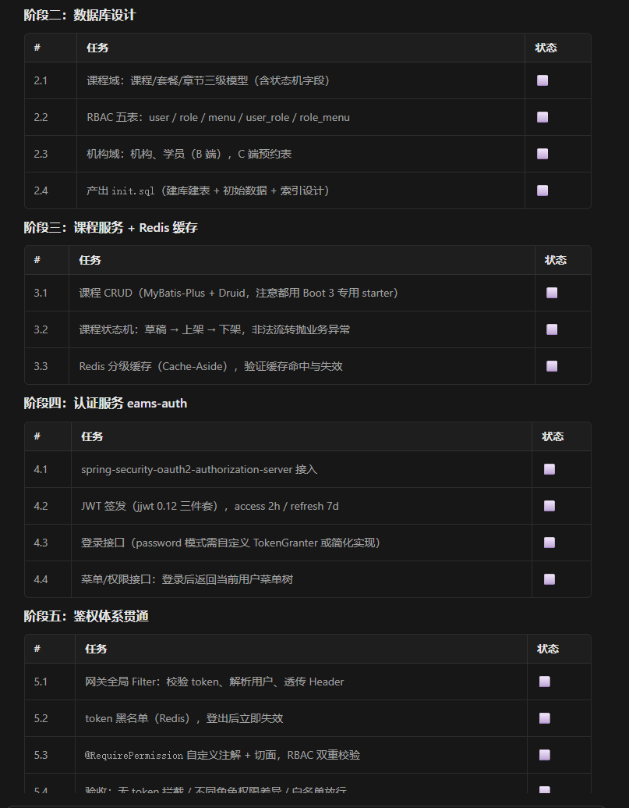
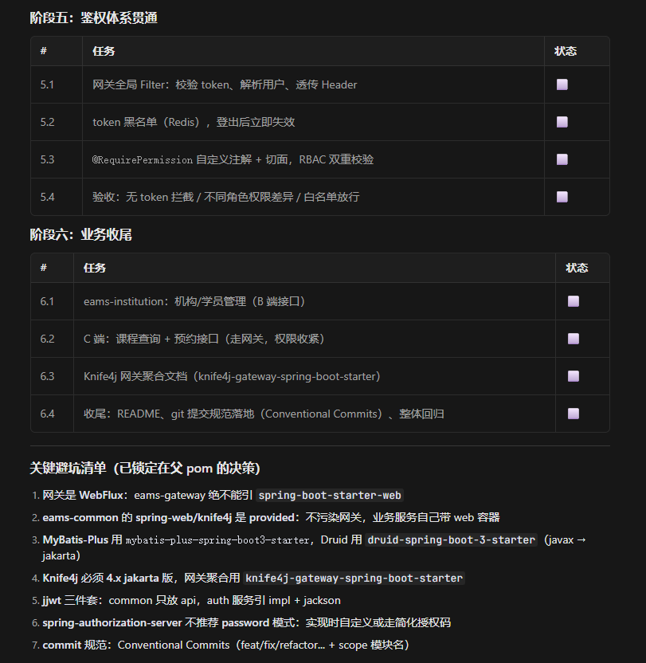

pom文件配置环境 让ai按需添加

公共模块:
com.eams.common 下的 api 、enums 、exception 、context 、constant

api 放对外的数据契约（会出现在接口出参里的类）
  Result(所有接口的出参统一形状)
    - 泛型<T> ：查询课程返回 Result<CourseVO> ，删除返回 Result<Void> ，一个类适配所有接口
    - 私有构造 + 静态工厂 ：禁止外部 new Result() 乱设 code，只能走 success()/failed() ，保证响应结构永远可控
    - timestamp 赋 ：私有构造里 System.currentTimeMillis() ，每个构造链都过这里，保证一定有值
  PageResult(分页字段不放 Result 里,Result 是通用信封，分页只是 data 的一种形态。出参长这样：Result<PageResult<CourseVO>> )
    - 5 个字段：pageNum, pageSize, total, pages, list（泛型 List<T>）
    - 关键实现有一处:pages 向上取整
    
enums 放枚举 
  ResultCode(Result、BizException、异常处理器全都依赖它)
    - 成功 → 200
    - 前端传参错了 → 400
    - 没登录 / token 过期 → 401
    - 登录了但没权限 → 403
    - 资源不存在 → 404
    - 服务器炸了 → 500
    - 业务规则不满足（余额不足、课程已下架）→ 600（自定义业务段）

exception 放异常体系（throw / 统一捕获）

context 放上下文持有（贯穿一次请求的“当前用户”）

constant 放常量（跨模块约定的字符串/数字）

