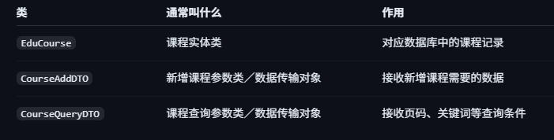

## commit规范
`feat` 新功能 `fix` 修 bug `docs` 文档 `chore` 杂活（依赖、配置、构建） `refactor` 重构（不改功能） `style` 格式（空格、缩进，不动逻辑）


## 业务异常

> **项目位置**
>
> - `/eams-parent/eams-common/src/main/java/com/eams/common/exception/BizException.java`：业务异常类 `BizException`；下面的四个重载构造方法都写在这个类里。
> - `/eams-parent/eams-common/src/main/java/com/eams/common/enums/ResultCode.java`：关联的响应码枚举 `ResultCode`，如 `UNAUTHORIZED`、`BUSINESS_ERROR`。
>
> 以下路径从项目根目录 `/eams-parent/` 写起；`src/main/java` 后的 `com/eams/...`，对应 IDE 中显示的 `com.eams...` 包。

```plaintext
@Getter
public class BizException extends RuntimeException{
    //编号
    private final int code;
    //消息消息
    private final String message;

    //直传一句话
    public BizException(String message){
        this(600,message); //下面接
    }

    //指定编号+指定内容
    public BizException(int code, String message){
        super(message); //把message交给父类RuntimeException
        this.code = code; //编号
        this.message = message; //消息内容
    }

       //指定枚举
    public BizException(ResultCode resultCode){
        this(resultCode.getCode(), resultCode.getMessage()); //交给上面的构造方法
    }

    //用枚举编号+指定内容
    public BizException(ResultCode resultCode, String message){
        this(resultCode.getCode(), message); //一样
    }
}
```

`this.code = code` 里的`this.` 就是为了在"字段名和参数名同名"时，指代"这个对象自己的字段"。

> 这里都是构造方法，方法名必须跟类名相同，不能有返回值。

- 构造方法是干嘛的
造对象用的，当你写`new BizException("余额不足")` 时，Java 就会去执行`BizException(String msg)` 这个构造方法（调构造器），把对象"初始化"好（把 code、message 填进去）。

- 为什么有 4 个名字都一样的构造方法？
因为它们的参数不一样 ，Java 允许"名字相同、参数不同"的方法共存，这叫 <span style="color:#ea580c">**重载**</span> 。

- `this(600, msg)` ，意思是： 在这个构造方法里，去调用本类另一个构造方法 （带括号的 this = 调构造器）。作用是"偷懒"，把活儿转给更全的那个构造器去干。

- 场景假设
将来某处代码写了这么一句：
`throw new BizException(502, "余额不足");`
意思就是：造一个异常对象，编号是 502，内容写"余额不足"。这时 Java 会自动跑你这个构造方法，把`502` 和`"余额不足"` 传进去。

- 现在代码逐行走
`public BizException(int code, String message) {`
这一行 = 声明构造方法的门面，意思是"谁想造 BizException 对象，就得给我传一个`int` 和一个`String` "。传进来的值，Java 用 两个临时盒子 接住，盒子分别叫`code` 和`message` 。
执行到这里时，两个盒子里装的是：
```plaintext
code    = 502
message = "余额不足"
```

然后

`    super(message);`
`super` 是"我爹"（父类 RuntimeException）。这句话 = "爹，我这儿有个消息，你先帮我存一份"。Java 规定异常类必须先跟父类报备消息，这一行 <span style="color:#ea580c">**必须写在第一句**</span> 。
执行后：父类 RuntimeException 内部也存了一份`"余额不足"` （将来打日志、打印错误堆栈时要用它）。

然后

`    this.code = code;`
拆开看：
- `code` 
（右边的）= 传进来的临时盒子，值`502`

- `this.code` 
（左边的）= 类自己那个正式的字段`private final int code`
这句话 = "把传进来的 502，存进对象自己的 code 字段里"。
执行后：
`对象自己的 code 字段 = 502     ← 现在有值了`
然后
`    this.message = message;`
同理

- 全部执行完，你得到了一个对象
```plaintext
BizException 对象
├── code    = 502
├── message = "余额不足"
└── (父类 RuntimeException 里也存了 "余额不足")
```
这就是`new BizException(502, "余额不足")` 造出来的完整东西。

- 那 get 是在干嘛
`getCode()` 和`getMessage()` 是`@Getter` 自动生成的两个方法，作用就是" 从包裹(传进来的枚举对象)里把值取出来 "：

- `resultCode.getCode()` 
从包裹里取出`401`

- `resultCode.getMessage()` 
从包裹里取出`"未登录"`


---------------------------------------------------------------------------------------------
## 当前登录用户上下文

> **项目位置**
>
> - `/eams-parent/eams-common/src/main/java/com/eams/common/context/UserContext.java`：公共模块中的 `UserContext` 类，包含 `USER_HOLDER`、`set(...)`、`get()`、`getUserId()`、`requireLogin()`、`remove()`，以及内部类 `UserInfo`。

```plaintext
/**
 * 当前登录用户上下文：用户信息挂在当前线程上
 */
public final class UserContext {
    private UserContext(){}

    //线程存库
    private static final ThreadLocal<UserInfo> USER_HOLDER = new ThreadLocal<UserInfo>();

    //放进
    public static void set(UserInfo user){
        USER_HOLDER.set(user);
    }

    //取出
    public static UserInfo get(){
        return USER_HOLDER.get();
    }

    //只取 userId 没登陆返回null
    public static Long getUserId(){
        UserInfo user = USER_HOLDER.get();
        return user == null ? null : user.getUserId();
    }

    //强校验 没登录抛401
    public static UserInfo requireLogin(){
        UserInfo user = USER_HOLDER.get();
        if (user == null){
            throw new BizException(ResultCode.UNAUTHORIZED);
        }
        return user;
    }

    //清空 请求结束时调用
    public static void remove(){
        USER_HOLDER.remove();
    }

    //内嵌类（装用户信息）
    @Data
    public static class UserInfo{
        private Long userId; //用户ID
        private String username; //用户名
        private String realName; //真实姓名
        private Integer userType; //用户类型（1 2 3 4）
        private Long institutionId; //所属机构ID（给B端用）
    }
}
```
---------------------------------------------------------------------------------------------


## 工具类 

> **项目位置**
>
> - `/eams-parent/eams-common/src/main/java/com/eams/common/context/UserContext.java`：本节工具类写法对应 `UserContext`：私有构造方法、静态 `ThreadLocal` 和下面逐个讲解的静态方法都在这里。`UserInfo` 也是这个文件中的内部类。
>
> `ThreadLocal` 由 JDK 提供，`@Data` 由 Lombok 提供；项目里查看它们的使用位置即可，自动生成的 getter 不需要另建源码文件。

```plaintext
public final class ***{
    private ***(){}
}
private static final ThreadLocal<UserInfo> USER_HOLDER = new ThreadLocal<UserInfo>();
//这样线程存储库就建好了 下面再写方法就好；
```


```plaintext
   public static void set(UserInfo user){
        USER_HOLDER.set(user);
    }
```
外面调用时，传进来UserInfo类型的对象，在这个方法里取个名字叫user，让后.set（user）调用ThreadLocal自带的set方法把user放进存储库；


```plaintext
    public static UserInfo get(){
        return USER_HOLDER.get();
    }
```
return就是交结果 从左往右看好理解一点 .get()取完值后用return返回给调用这个方法的人 并且返回值类型一定是UserInfo类型的；


```plaintext
  public static Long getUserId(){
        UserInfo user = USER_HOLDER.get();
        return user == null ? null : user.getUserId();
    }
```
￥ ？ 1 ： 2；意思就是在￥条件下成功返回1，否则返回2；

> [!IMPORTANT]
> 这里的第一行的getUserId是static方法，给外部直接类名.方法名调用的；第三行的getUserId是@Data自动生成的实例方法，需要先创建一个UserInfo对象（user），才能调用；

关于@Data
Lombok 的「自动生成规则」写的确实是字段`userId` ，Lombok 就是 根据这个字段名自动拼出 getter 方法名 的。
规则：get + 字段名首字母大写
Lombok 看到字段：
`private Long userId;`
就自动在编译时生成：
```plaintext
public Long getUserId(){
    return this.userId;
}
```


```plaintext
    public static UserInfo requireLogin(){
        UserInfo user = USER_HOLDER.get();
        if (user == null){
            throw new BizException(ResultCode.UNAUTHORIZED);
        }
        return user;
    }
```
```plaintext
        public static void remove(){
        USER_HOLDER.remove();
    }
```

> [!TIP]
> “手环检验”在真检验（token相关）后再检验，确保用户已登录，防止未登录者修改业务。token是门票，requireLogin是手环（进场上线到线程池），进场看门票和手环，出场撕掉手环（下线，后面的remov方法），避免任务完成的线程信息残留在线程池里。
---------------------------------------------------------------------------------------------


## 全局异常处理器

> **项目位置**
>
> - `/eams-parent/eams-common/src/main/java/com/eams/common/exception/GlobalExceptionHandler.java`：类 `GlobalExceptionHandler`；业务异常处理看 `handleBizException(...)`，请求体校验异常处理看 `handleMethodArgumentNotValid(...)`。
> - `/eams-parent/eams-common/src/main/java/com/eams/common/api/Result.java`：统一返回对象 `Result<T>`；本节返回失败信息时调用这里的 `failed(...)`。
> - `/eams-parent/eams-common/src/main/java/com/eams/common/enums/ResultCode.java`：处理器用到的 `VALIDATE_FAILED`、`SYSTEM_ERROR` 等响应码。

```plaintext
/**
 * 全局异常处理器 接所有异常 转成Result结构返回
 */
@ConditionalOnWebApplication(type = ConditionalOnWebApplication.Type.SERVLET) 
//Web专用 只在 Servlet 类型的 Web 项目里生效
@RestControllerAdvice
//"全局异常处理中心"，能拦截异常并给前端返回 JSON
@Slf4j
public class GlobalExceptionHandler {
        //业务异常（BizException）
    @ExceptionHandler(BizException.class)
    public Result<Void> handleBizException(BizException e){
    //异常对象打包成e 返回一个Result，没有业务数据所以<Void>返回值自动变成json给前端
        log.warn("业务异常:{}", e.getMessage());
        //e就是BizException的对象名，对象名.方法名() 来调用方法
        return Result.failed(e.getCode(), e.getMessage());
        //.failed用到Result类的静态工厂方法，返回一个失败的Result对象
    }
//前端收到{ "code": 401, "message": "未登录或登录已过期", "data": null, "timestamp": 1730000000000 }

//后面的常规异常都是spring自带的异常，直接用即可（ MethodArgumentNotValidException.class BindException.class......... ）

//Stream流处理
    //@RequestBody参数的@Valid校验失败
    @ExceptionHandler(MethodArgumentNotValidException.class)
    public Result<Void> handleMethodArgumentNotValid(MethodArgumentNotValidException e){
        String message = e.getBindingResult().getFieldErrors().stream()
        //链式调用
        e.getBindingResult()          // 返回 BindingResult 对象
        .getFieldErrors()           // BindingResult 有 getFieldErrors() 方法 继续调用
        .stream()                   // 前面的方法返回的 List 有 stream() 方法 
                .map(FieldError::getDefaultMessage)
                //对流水线上的 每一个 FieldError，调用它的`getDefaultMessage()` 方法
                .findFirst()
                .orElse(ResultCode.VALIDATE_FAILED.getMessage());
        log.warn("参数校验失败:{}", message);
        return Result.failed(ResultCode.VALIDATE_FAILED.getCode(), message);
    }

//spring自己调用，拿到返回的Result自动转成json给前端。spring框架替我调用，我只管写逻辑，这就是Spring的控制反转（Spring IOC）
① 参数校验失败 → Spring 自动 throw MethodArgumentNotValidException
② Spring 捕获异常，找到 @ExceptionHandler 对应的这个方法
③ Spring 自动调用 handleMethodArgumentNotValid(e)   ← 调用者是 Spring
④ 方法里 return Result.failed(...)                    ← 结果还给 Spring
⑤ Spring 拿到这个 Result，转成 JSON                     ← Spring 再转给前端
⑥ 前端收到 {"code":400, "message":"...", ...}
}
```


## 网关

> **项目位置**
>
> - `/eams-parent/eams-modules/eams-gateway/src/main/resources/application.yml`：网关服务配置；路由转发看 `spring.cloud.gateway.routes`，其中 `/system/**` 对应 `lb://eams-system`。
> - `/eams-parent/eams-modules/eams-gateway/pom.xml`：网关依赖配置，查看 `spring-cloud-starter-gateway`。
> - `/eams-parent/eams-modules/eams-gateway/src/main/java/com/eams/gateway/EamsGatewayApplication.java`：网关启动入口 `EamsGatewayApplication.main(...)`。

网关做的事就叫 路由转发 ：`http://localhost:8080/system/xxx` → 自动转发到`eams-system` 服务。

//一个必须记住的坑
网关用的是 WebFlux + Netty （反应式、异步非阻塞），它跟`spring-boot-starter-web` （Servlet + Tomcat 同步模型）是 两套完全不同的引擎 。
用汽油车/柴油车打比方：一辆车只能装一种发动机，两个都塞进去就当场报错。所以：
 网关里绝对不能加`spring-boot-starter-web` ，否则启动直接冲突报错。


## MyBatis-Plus

> **项目位置**
>
> - `/eams-parent/eams-modules/eams-system/src/main/java/com/eams/system/mapper/SysUserMapper.java`：用户数据库操作接口 `SysUserMapper`，通过 `extends BaseMapper<SysUser>` 使用通用增删改查。
> - `/eams-parent/eams-modules/eams-system/src/main/java/com/eams/system/entity/SysUser.java`：Mapper 的泛型实体 `SysUser`，通过 `@TableName` 对应用户表。
> - `/eams-parent/eams-modules/eams-system/pom.xml`：该模块引入 MyBatis-Plus 的位置，依赖名为 `mybatis-plus-spring-boot3-starter`。

//继承BaseMapper用


## 数据源

> **项目位置**
>
> - `/eams-parent/eams-modules/eams-system/src/main/resources/application.yml`：本节开头的数据源配置放在 `spring.datasource` 下。
> - `/eams-parent/eams-modules/eams-system/src/main/java/com/eams/system/entity/SysUser.java`：本节的用户实体 `SysUser`，对应 `sys_user` 表。
> - `/eams-parent/eams-modules/eams-system/src/main/java/com/eams/system/mapper/SysUserMapper.java`：本节的数据库操作接口，继承 `BaseMapper<SysUser>`。
> - `/eams-parent/eams-modules/eams-system/src/main/java/com/eams/system/controller/UserController.java`：本节数据库连通测试的 `list()` 所在文件；早期直接调用 Mapper 的写法仍保留在该文件顶部的注释中，当前接口通过 Service 查询。

  datasource:
    driver-class-name: com.mysql.cj.jdbc.Driver
    url: "jdbc:mysql://127.0.0.1:3306/eams?useUnicode=true&characterEncoding=utf8&serverTimezone=Asia/Shanghai&useSSL=false&allowPublicKeyRetrieval=true"
    username: root
    password: "****"

  /**
  * 系统用户实体
 */
@Data
@TableName("sys_user")
public class SysUser {

    @TableId(type = IdType.AUTO)
    private Long id;

    private String username;

    private String nickname;

    private LocalDateTime createTime;
}

/**
 * 用户Mapper 继承BaseMapper
 */
public interface SysUserMapper extends BaseMapper<SysUser> {
}

/**
 * 检验数据库连通
 */
@RestController
@RequestMapping("/system/user")
public class UserController {
    
    private final SysUserMapper sysUserMapper;
    
    public UserController(SysUserMapper sysUserMapper){
        this.sysUserMapper = sysUserMapper;
    }
    
    @GetMapping("/list")
    public List<SysUser> list(){
        return sysUserMapper.selectList(null);
    }
}

- 数据源 ：怎么告诉 Spring「数据库在哪、账号密码」。

- 建表 → 实体类 → Mapper 三层对应关系，以及`@TableName` 、`@TableId` 两个翻译锚点。


## MyBatis-Plus 的 Service 也是"白送"的，继承两个套件`IService` +`ServiceImpl` ，跟 Mapper 一样自动拥有一堆方法（`list` /`getById` /`save` /`updateById` …）。

> **项目位置**
>
> - `/eams-parent/eams-modules/eams-system/src/main/java/com/eams/system/service/SysUserService.java`：用户业务接口，`extends IService<SysUser>` 写在这里。
> - `/eams-parent/eams-modules/eams-system/src/main/java/com/eams/system/service/impl/SysUserServiceImpl.java`：用户业务实现类，`extends ServiceImpl<SysUserMapper, SysUser>` 与 `implements SysUserService` 写在这里。
>
> `IService`、`ServiceImpl` 是 MyBatis-Plus 依赖中的类型；项目中自己的文件是上面的接口和实现类。


## 分页查询\

> **项目位置**
>
> - `/eams-parent/eams-modules/eams-system/src/main/java/com/eams/system/config/MybatisPlusConfig.java`：系统服务的分页插件配置；查看 `MybatisPlusConfig.mybatisPlusInterceptor()` 中添加的 `PaginationInnerInterceptor`。
> - `/eams-parent/eams-modules/eams-system/src/main/java/com/eams/system/service/SysUserService.java`：声明用户分页方法 `pageQuery(...)` 的业务接口。
> - `/eams-parent/eams-modules/eams-system/src/main/java/com/eams/system/service/impl/SysUserServiceImpl.java`：实现 `pageQuery(...)`：创建 `Page<SysUser>`、执行分页并封装结果。

///**
 * MyBatis plus配置：分页插件
 */
@Configuration
public class MybatisPlusConfig {

    @Bean
    public MybatisPlusInterceptor mybatisPlusInterceptor(){
        MybatisPlusInterceptor interceptor = new MybatisPlusInterceptor();
        //分页拦截器
        interceptor.addInnerInterceptor(new PaginationInnerInterceptor(DbType.MYSQL));
        return interceptor;
    }
}
//SysUserService 增加 pageQuery 分页方法来用


## 补全增删改

> **项目位置**
>
> - `/eams-parent/eams-modules/eams-system/src/main/java/com/eams/system/controller/UserController.java`：用户接口类；新增、修改、删除分别定位 `add(...)`、`update(...)`、`delete(...)`，接口前缀为 `/system/user`。
> - `/eams-parent/eams-modules/eams-system/src/main/java/com/eams/system/service/impl/SysUserServiceImpl.java`：当前新增和修改的业务处理看 `addUser(...)`、`updateUser(...)`；删除使用继承的 `removeById(...)`。
> - `/eams-parent/eams-common/src/main/java/com/eams/common/api/Result.java`：接口中 `Result.success(...)` 对应的统一响应封装。

// 新增用户：请求体里塞一段 JSON，Spring 自动翻译成 SysUser 对象
@PostMapping
public Result<Void> add(@RequestBody SysUser user){
    sysUserService.save(user);          // IService 自带的新增方法
    return Result.success();
}

// 修改用户：同样读请求体 JSON，但这次 JSON 里必须带 id
@PutMapping
public Result<Void> update(@RequestBody SysUser user){
    sysUserService.updateById(user);    // 根据 id 更新
    return Result.success();
}

// 删除用户：id 直接写在 URL 里，比如 /system/user/5
@DeleteMapping("/{id}")
public Result<Void> delete(@PathVariable Long id){
    sysUserService.removeById(id);      // 根据 id 删除
    return Result.success();
}

- `@RequestBody` 
负责"把 JSON 翻译成`SysUser` 对象"；

- `@Valid` 
负责"翻译完之后，按`SysUser` 里写好的注解（`@NotBlank` 、`@Size` 等校验注解），把这个对象检查一遍"。


## Knife4j/OpenAPI接口测试文档配置

> **项目位置**
>
> - `/eams-parent/eams-modules/eams-system/pom.xml`：本节 `pom:` 部分，Knife4j starter 依赖声明在这里。
> - `/eams-parent/eams-modules/eams-system/src/main/java/com/eams/system/config/Knife4jConfig.java`：本节 `config:` 部分，类 `Knife4jConfig` 的 `openAPI()` 方法配置接口文档标题、描述和版本。
> - `/eams-parent/eams-modules/eams-system/src/main/resources/application.yml`：本节 `yml:` 部分，查看顶层的 `springdoc` 和 `knife4j` 配置。
> - `/eams-parent/pom.xml`：父工程统一管理 Knife4j 依赖版本的位置。

pom:
        <!-- Knife4j -->
        <dependency>
            <groupId>com.github.xiaoymin</groupId>
            <artifactId>knife4j-openapi3-jakarta-spring-boot-starter</artifactId>
        </dependency>

config:
/**
 * Knife4j/OpenAPI接口测试文档配置
 */
@Configuration
public class Knife4jConfig {

    @Bean
    public OpenAPI openAPI(){
        return new OpenAPI()
                .info(new Info()
                        .title("EAMS 教培管理系统 - 系统服务接口文档")
                        .description("sys_user 用户管理等系统模块接口")
                        .version("1.0.0"));
    }
}

yml：
springdoc:
  api-docs:
    enabled: true #接口数据源
  swagger-ui:
    enabled: true #接口文档界面

knife4j:
  enable: true
  setting:
    language: zh_cn


## DLC ----------------------------------------------------------
## 关于Spring：
Spring 是地基，Spring Boot 是盖在地基上的“精装脚手架” 。两者并非并列的替代关系，Spring Boot 并不是另一个新框架；它只是对 Spring 的自动化封装。

## Spring 到底是什么
“Spring”这个词其实指一整个家族，最底层的是 Spring Framework 。它提供的是这些“能力零件”：

模块 作用 IoC / DI 容器 帮你 new 对象、管对象、注入依赖 AOP 日志、事务这类横切逻辑抽出去 事务管理 `@Transactional` 背后的实现 Spring MVC 处理 HTTP 请求、路由到 Controller 数据访问 JdbcTemplate、整合 MyBatis / JPA

问题是：这些零件 全靠你手动拼装 。用传统 Spring 写一个 Web 项目，要写`web.xml` 、`applicationContext.xml` ，手动配 DispatcherServlet、数据源、事务管理器……配置量可能比业务代码还多。


## Spring Boot 干了什么
Spring Boot 不做新功能 ，它只做三件事，把上面那套拼装活儿自动化：

1. 起步依赖（starter） ：一个依赖顶一堆。引入`spring-boot-starter-web` ，Spring MVC、Jackson、内嵌 Tomcat 就都齐了，版本还帮你对齐好。
2. 自动配置 ：类路径里有什么 jar，它就按约定帮你配好对应的 Bean。有 Tomcat 就配 Web 环境，有 MySQL 驱动就配数据源——这就是“约定优于配置”。
3. 内嵌服务器 + 启动类 ：打成一个 jar，`java -jar` 直接跑，不用再装外部 Tomcat、部署 war 包。


## 注解
- Spring 容器 = 一个大工具箱 。
- `@Bean` = 往工具箱里"放一件工具"
- `@Configuration` = 告诉 Spring："这个类里放工具了，帮我登记一下。"
好处：以后谁要用这件工具， 不用自己`new` ，写个`@Autowired` ，Spring 就从工具箱里递给你。全项目共用同一个实例，而且以后想换，只改这一个地方。
## DLC ----------------------------------------------------------


## JWT

> **项目位置**
>
> - `/eams-parent/eams-modules/eams-system/src/main/java/com/eams/system/util/JwtUtil.java`：JWT 工具类；签发 token 看 `generateToken(...)`，解析 token 看 `parseToken(...)`。
> - `/eams-parent/eams-modules/eams-system/src/main/java/com/eams/system/service/SysUserService.java`：本节“接口”部分，`login(LoginDTO loginDTO)` 的声明。
> - `/eams-parent/eams-modules/eams-system/src/main/java/com/eams/system/service/impl/SysUserServiceImpl.java`：本节“实现”部分，构造方法注入 `PasswordEncoder`，`login(...)` 校验账号密码并调用 `JwtUtil.generateToken(...)`。
> - `/eams-parent/eams-modules/eams-system/src/main/java/com/eams/system/dto/LoginDTO.java`：登录方法接收的参数对象，保存 `username` 和 `password`。
> - `/eams-parent/eams-modules/eams-system/src/main/java/com/eams/system/controller/UserController.java`：对外的登录入口 `login(...)`，对应 `POST /system/user/login`。

//JWT工具类
public class JwtUtil {
    //token
    private static final String SECRET = "eams-jwt-secret-key-please-change-me-2026";

    //token有效期7天
    private static final long EXPIRE = 604800000;

    //转换
    private static final SecretKey KEY = Keys.hmacShaKeyFor(SECRET.getBytes());

    //生成token
    public static String generateToken(Long userId, String username) {
        return Jwts.builder()
                .subject(username) // 设置主题
                .claim("userId", userId) // 添加自定义声明
                .issuedAt(new Date()) // 设置签发时间
                .expiration(new Date(System.currentTimeMillis() + EXPIRE)) //过期时间
                .signWith(KEY)  //防伪
                .compact(); //打包
    }

    //解析token
    public static Claims parseToken(String token) {
        return Jwts.parser()
                .verifyWith(KEY)
                .build()
                .parseSignedClaims(token)
                .getPayload();
    }
}

接口
    /**
     * 登录：校验用户名密码，成功返回 token
     */
    String login(LoginDTO loginDTO);
实现
    private final PasswordEncoder passwordEncoder;

    //构造器注入 让Spring传入 BCryptPasswordEncoder
    public SysUserServiceImpl(PasswordEncoder passwordEncoder) {
        this.passwordEncoder = passwordEncoder;
    }
        @Override
    public String login(LoginDTO loginDTO) {
        //根据用户名查用户
        SysUser user = this.getOne(new LambdaQueryWrapper<SysUser>()
                .eq(SysUser::getUsername, loginDTO.getUsername()), false);
        //用户不存在
        if (user == null || !passwordEncoder.matches(loginDTO.getPassword(), user.getPassword())) {
            throw new BizException(ResultCode.UNAUTHORIZED, "用户名或密码错误");
         }

        //登陆成功
        return JwtUtil.generateToken(user.getId(), user.getUsername());
        }

- `LambdaQueryWrapper`
MyBatis-Plus 的"链式查询条件"，`.eq(字段, 值)` = "字段等于值"，不用手写 SQL。`getOne(..., false)` 里的`false` 意思是"如果查到多条不抛异常，取第一条"。

- `passwordEncoder.matches(明文, 密文)` 
BCrypt 是单向的，只能"比对"不能"解密"，返回 true/false。

- 为什么统一提示"用户名或密码错误" 
不告诉攻击者"到底是账号不存在还是密码错"，防止恶意试探出哪些用户名存在。

- 失败时抛`BizException(ResultCode.UNAUTHORIZED, ...)` 
会被 GlobalExceptionHandler ` 返回 这就是项目里"业务异常统一抛出"的用法。


## 密码加密方式

> **项目位置**
>
> - `/eams-parent/eams-modules/eams-system/src/main/java/com/eams/system/config/SecurityConfig.java`：`SecurityConfig.passwordEncoder()` 创建并注册 `BCryptPasswordEncoder`。
> - `/eams-parent/eams-modules/eams-system/src/main/java/com/eams/system/service/impl/SysUserServiceImpl.java`：本节密码比对的 `if` 在 `login(...)` 内；新增、修改密码的 `encode(...)` 分别在 `addUser(...)`、`updateUser(...)` 内。

BCrypt 每次加密同一份明文，结果都不一样，因为他会再密文里加一个随机的盐（随机字符）
比如同样123的密码，每次加密出的结果都不同就是因为盐不一样。这样数据库里存的每个人的密码密文都是独立的。
这里用 matches(明文, 密文) 去检验那个数据库里存好的盐；

`matches` 内部干的事是这样：
1. 从数据库的密文里取出盐。
2. 用这个 同一把盐 + 你输入的明文，重新算一遍哈希。
3. 比"算出来的结果"和"数据库里存的"是不是一致。
if (user == null || !passwordEncoder.matches(loginDTO.getPassword(), user.getPassword())) {
            throw new BizException(ResultCode.UNAUTHORIZED, "用户名或密码错误");
         }
        
tips：`!` 是取反，意思是" 只要比对不过（false），就走进 if 里抛异常 "。


## 盐

> **项目位置**
>
> - `/eams-parent/eams-modules/eams-system/src/main/java/com/eams/system/config/SecurityConfig.java`：本节概念在项目中的对应入口是 `passwordEncoder()`，使用 `BCryptPasswordEncoder`。
> - `/eams-parent/eams-modules/eams-system/src/main/java/com/eams/system/service/impl/SysUserServiceImpl.java`：查看 `addUser(...)`、`updateUser(...)` 中的 `encode(...)` 和 `login(...)` 中的 `matches(...)`。
>
> 盐的生成、保存格式和比对由 BCrypt 依赖内部处理，仓库中没有单独的盐值工具类。

`salt` （盐值）。它是密码学里一个通用概念，不光 BCrypt 用，SHA-256 加盐、PBKDF2、Argon2 这些加密方案全都用。
盐就是一段随机字符串 。加密前，把"密码 + 盐"混在一起再哈希。
不加盐：  hash("123456")                 → 所有人结果都一样
加盐：    hash("123456" + "随机盐A")      → 张三的结果 ≠ 李四的结果


## DTO

> **项目位置**
>
> - `/eams-parent/eams-modules/eams-system/src/main/java/com/eams/system/dto/LoginDTO.java`：本节专门接收登录参数的 DTO，字段为 `username`、`password`。
> - `/eams-parent/eams-modules/eams-system/src/main/java/com/eams/system/entity/SysUser.java`：本节对照的数据库实体 `SysUser`，密码字段的 JSON 注解在该文件中。
> - `/eams-parent/eams-modules/eams-system/src/main/java/com/eams/system/controller/UserController.java`：在 `login(@Valid @RequestBody LoginDTO loginDTO)` 处接收这个 DTO。

`password` 加的`@JsonIgnore` ，其实会 同时屏蔽两个方向 ：

- 输出 （返回给前端）
密码被隐藏 ✅ 这是我们要的。

- 输入 （前端传进来）
密码也读不进来 ❌ 这是副作用。
所以`SysUser` 不能 用来当登录的请求体（否则 password 根本收不到）。而且登录只需要`username + password` 两个字段，没必要塞整个实体。

结论：建一个专门的`LoginDTO` 来收登录参数。 DTO = 专门给前端"传进/传出"用的对象 ，跟数据库实体分开，这就是之前说的"彻底隔离"。
----------------------------------------------------------
## JWT 拦截器 + 注册放行路径

> **项目位置**
>
> - `/eams-parent/eams-modules/eams-system/src/main/java/com/eams/system/interceptor/JwtInterceptor.java`：本节第一个类 `JwtInterceptor`；`preHandle(...)` 检查 token，`reject(...)` 写出 401 响应。
> - `/eams-parent/eams-modules/eams-system/src/main/java/com/eams/system/config/WebMvcConfig.java`：本节第二个类 `WebMvcConfig`；`addInterceptors(...)` 注册拦截器，`excludePathPatterns(...)` 配置放行路径。
> - `/eams-parent/eams-modules/eams-system/src/main/java/com/eams/system/util/JwtUtil.java`：拦截器调用的 token 解析方法 `parseToken(...)`。

/**
 * JWT 登录拦截器：校验请求头里的 token，不合法就拦截返回 401
 */
@Component
public class JwtInterceptor implements HandlerInterceptor {

    private final ObjectMapper objectMapper;

    // 注入 Spring 的 ObjectMapper（把 Result 转成 JSON 写回给前端）
    public JwtInterceptor(ObjectMapper objectMapper) {
        this.objectMapper = objectMapper;
    }

    @Override
    public boolean preHandle(HttpServletRequest request, HttpServletResponse response, Object handler) throws Exception {
        //从请求头里拿 token
        String token = request.getHeader("Authorization");

        //没带 token，或格式不对 拦截
        if (token == null || !token.startsWith("Bearer ")) {
            return reject(response);
        }

        //去掉 "Bearer " 前缀，拿到真正的 token
        token = token.substring(7);

        try {
            //解析 token，过期/伪造/被篡改都会抛异常
            JwtUtil.parseToken(token);
        } catch (Exception e) {
            // 解析失败  拦截
            return reject(response);
        }

        //token 合法 → 放行
        return true;
    }

    // 拦截并返回 401（把错误信息写成 JSON 写回给前端）
    private boolean reject(HttpServletResponse response) throws Exception {
        response.setStatus(HttpServletResponse.SC_UNAUTHORIZED); // HTTP 状态码 401
        response.setContentType("application/json;charset=UTF-8");
        Result<Void> result = Result.failed(ResultCode.UNAUTHORIZED);
        response.getWriter().write(objectMapper.writeValueAsString(result));
        return false; // 返回 false = 拦截
    }
}

/**
 * Web 配置：注册 JWT 拦截器，并配置哪些路径需要登录、哪些放行
 */
@Configuration
public class WebMvcConfig implements WebMvcConfigurer {

    private final JwtInterceptor jwtInterceptor;

    public WebMvcConfig(JwtInterceptor jwtInterceptor) {
        this.jwtInterceptor = jwtInterceptor;
    }

    @Override
    public void addInterceptors(InterceptorRegistry registry) {
        registry.addInterceptor(jwtInterceptor)
                .addPathPatterns("/**")           // 拦所有请求
                .excludePathPatterns(             // 但这些路径放行（免登录）
                        "/system/user/login",     // 登录接口本身（否则没法登录）
                        "/doc.html",              // Knife4j 文档页面
                        "/webjars/**",            // Knife4j 静态资源
                        "/v3/api-docs/**",        // 接口文档 JSON
                        "/swagger-ui/**",         // swagger-ui 页面
                        "/favicon.ico",
                        "/error"
                );
    }
}

- `Authorization: Bearer xxx` 是啥？
这是 HTTP 行业约定：token 放在请求头`Authorization` 里，格式`Bearer 空格 token` 。`Bearer` 是"持有者"的意思，可以理解为"我拿这个凭证证明我是谁"。前端调接口时要在请求头带上它。

- 为什么拦截器里要"自己写 JSON"，而不是抛异常？
之前的`GlobalExceptionHandler` 管不到拦截器 。因为：
拦截器的`preHandle` 在 Controller 之前 执行。
`@RestControllerAdvice` 只能捕获 Controller 里 抛出的异常。
拦截器里抛异常，会直接变成 500 错误页，不会变成我们想要的 JSON。
所以拦截器里要 手动 把 401 和错误 JSON 写回`response` ，然后`return false` 拦下。

- `addPathPatterns("/**")` +`excludePathPatterns(...)` 
就是"看门规则"

- `addPathPatterns` 
大爷站哪些门（所有门`/**` ）。

- `excludePathPatterns` 
大爷手里的"免检名单"（登录接口、文档页面不用查证件）。

注意： 登录接口`login` 必须放行 ，否则连登录都登录不了，就死锁了。


## 拦截器类里的线程 用上UserContext

> **项目位置**
>
> - `/eams-parent/eams-modules/eams-system/src/main/java/com/eams/system/interceptor/JwtInterceptor.java`：`preHandle(...)` 的 `try` 块解析 claims 并调用 `UserContext.set(...)`；请求结束时在 `afterCompletion(...)` 中调用 `UserContext.remove()`。
> - `/eams-parent/eams-common/src/main/java/com/eams/common/context/UserContext.java`：用户信息的实际存放位置，查看 `USER_HOLDER` 和内部类 `UserInfo`。

  JwtInterceptor类下

try {
            Claims claims = JwtUtil.parseToken(token);

            //从 token 里取出 userId 和 username
            //用 toString 统一转
            Object userIdObj = claims.get("userId");
            Long userId = userIdObj == null ? null : Long.valueOf(userIdObj.toString());
            String username = claims.getSubject();

            // 装进 UserInfo，挂到当前线程的抽屉里
            UserContext.UserInfo userInfo = new UserContext.UserInfo();
            userInfo.setUserId(userId);
            userInfo.setUsername(username);
            UserContext.set(userInfo);
        } catch (Exception e) {
            //解析失败  拦截
            return reject(response);
        }

        //token 合法 → 放行
        return true;

    // 请求结束时调用：清空线程池
    @Override
    public void afterCompletion(HttpServletRequest request, HttpServletResponse response, Object handler, Exception ex) {
        UserContext.remove();
    }

- 为什么要`afterCompletion` 里`UserContext.remove()` ？
Tomcat 用 线程池 复用线程。一个请求处理完，线程会被拿去处理下一个请求。如果不清空抽屉：
下一个请求可能拿到 上一个请求留下的 userId → 严重的话会"串号"（A 的操作被当成 B 的）。
抽屉里的对象引用一直不被释放 → 内存泄漏。
所以"用完必须清"，这是 ThreadLocal 的铁律。

- `userIdObj.toString()` 这个写法是为什么？
我们存 token 时`userId` 是`Long` 。但 token 本质是 JSON，JSON 里`1` 这种小数字，解析回来时 可能是`Integer` 也可能是`Long` 。如果直接`(Long) claims.get("userId")` 强转，遇到`Integer` 就会 ClassCastException。用`Long.valueOf(toString())` 两种都能安全转。

- `get()` vs`requireLogin()`
`UserContext` 里有两个取法（已经写好了）：

- `get()` → 可能返回 null（宽松）。

- `requireLogin()` → 没登录就抛 401（严格）。

## JWT至此；
JWT：签 token、验 token、Header 里怎么传。
BCrypt：盐、单向哈希、`encode` /`matches` 。
Spring DI：`@Component` 、`@Bean` 、构造器注入、按类型注入。
拦截器：`HandlerInterceptor` 、放行规则、为什么拦截器里要手动写 JSON。
ThreadLocal +`UserContext` ：上下文传递、为什么用完必须`remove()` 。
## 现在系统具备的能力
用户登录 （JWT 签发 token）
用户增删改查 （分页、按 id 查、新增、更新、删除）
密码安全 （新增/更新都 BCrypt 加密，接口不泄露密码）
接口鉴权 （不带 token 返回 401）
/current （返回当前登录用户完整信息）


## 分页查询增强 

> **项目位置**
>
> - `/eams-parent/eams-modules/eams-system/src/main/java/com/eams/system/controller/UserController.java`：`list(...)` 接收 `pageNum`、`pageSize`、`keyword`、`userType`、`status`，接口为 `GET /system/user/list`。
> - `/eams-parent/eams-modules/eams-system/src/main/java/com/eams/system/service/SysUserService.java`：同步声明带筛选参数的 `pageQuery(...)`。
> - `/eams-parent/eams-modules/eams-system/src/main/java/com/eams/system/service/impl/SysUserServiceImpl.java`：在 `pageQuery(...)` 中组合关键词、用户类型和状态条件。


- 给`/list` 加上「关键词搜索 + 按用户类型/状态筛选」。
现在`/list` 只能干巴巴地翻页。增强后，前端可以传这 3 个 可选 参数：
`keyword` 关键词，模糊搜「用户名」或「手机号」 搜`张` 能匹配到"张三"
`userType` 按用户类型筛选 只查`1` 管理员 
`status` 按状态筛选 只查`1` 正常


## LambdaQueryWrapper

> **项目位置**
>
> - `/eams-parent/eams-modules/eams-system/src/main/java/com/eams/system/service/impl/SysUserServiceImpl.java`：本节 `wrapper` 的创建和 `and/like/or/eq` 条件都位于用户分页方法 `pageQuery(...)` 中。
> - `/eams-parent/eams-modules/eams-system/src/main/java/com/eams/system/service/SysUserService.java`：本节“接口加上参数”对应 `pageQuery(...)` 的方法声明。
> - `/eams-parent/eams-modules/eams-system/src/main/java/com/eams/system/entity/SysUser.java`：方法引用 `SysUser::getUsername`、`getPhone`、`getUserType`、`getStatus` 对应的实体字段；getter 由该类的 `@Data` 生成。

`LambdaQueryWrapper` 就是一张「 筛选条件清单 」。你先往清单上一条条写条件，写完后交给查询方法，它按清单去数据库筛数据。
常用三个"写条件"的动作：

- 具体操作
接口加上参数
String keyword, Integer userTpye, Integer status
实现
//构建条件构造器
        LambdaQueryWrapper<SysUser> wrapper = new LambdaQueryWrapper<>();
        //关键词模糊匹配（手机号，用户名）
        if (keyword != null && !keyword.isEmpty()) {
            wrapper.and(w -> w.like(SysUser::getUsername, keyword)
                    .or().like(SysUser::getPhone, keyword));
        }

- `wrapper.and(...)` 
往清单上加「 一组 条件」，这组条件内部用「或」连接，外面包一层括号。

- `w -> ...`
这是一个 lambda 表达式 ，`w` 代表「这组括号里的一个小清单」。可以读成：" 在这个小清单 w 上，做下面这些操作 "。

- `w.like(SysUser::getUsername, keyword)` 
在 w 上加一条：username 字段 包含 keyword。

- `and`( like().or().like() )
 包一个括号，括号里用`or` 连两个`like` ，实现"用户名或手机号模糊搜索"。

- `.or()` 
或者。

- `.like(SysUser::getPhone, keyword)` 
再加一条：phone 字段 包含 keyword。

- if (userType != null) {
     wrapper.eq(SysUser::getUserType, userType); }
如果传了`userType` ，就往清单加一条：`userType 等于 这个值` 。
`eq` = equal = 等于（精确匹配）。

- if (status != null) {
     wrapper.eq(SysUser::getStatus, status); }
同理
一般表设计为：
`userType` 用户类型 `1` = 管理员/老师，`0` = 普通用户 
`status` 账号状态 `1` = 正常启用，`0` = 禁用/停用

- tips：getter 的命名规则（JavaBean 规范）
        Lombok 的`@Data` 自动帮你生成 getter 时，有一套固定规则：
        `get` + 字段名首字母大写
        所以字段`status` 自动生成的 getter 方法叫`getStatus` （get + Status）。

- tips：`String` 文本/字符串 关键词`keyword` 、用户名、手机号、邮箱、地址 
        `Long` 整数 （64 位（19位数），能存 null） 页码`pageNum` 、条数`pageSize` 、主键 id 
        `Integer` 整数 （32 位（10位数），能存 null） 用户类型`userType` 、状态`status`
        注意：这里手机号应该是一种标识（后续不用他），所以这里用`String` 而不是`Long`，而且Long会把0开头的手机号的0去掉。

- tips：.eq（字段, 值）方法里面有两个参数
        ## 参数 1：SysUser::getUserType —— 指定"对哪个字段"
        这是方法引用（`::` 是方法引用符号）。它的作用是告诉 MyBatis-Plus： "我要操作的是`userType` 这个字段。"
         MyBatis-Plus 拿到`getUserType` 这个方法名，会 反推出字段名`userType` ，再转成数据库列名`user_type` 。

        ## 参数 2：userType —— 指定"等于什么值"
        这是你`pageQuery` 方法的 入参 （前端传来的那个整数，比如`1` ）。 
        最后=1的这个条件会加到清单里，在最后的最后同分页对象一起传给查询方法


## 最后执行 返回

> **项目位置**
>
> - `/eams-parent/eams-modules/eams-system/src/main/java/com/eams/system/service/impl/SysUserServiceImpl.java`：`pageQuery(...)` 末尾的 `this.page(page, wrapper)` 和 `return PageResult.of(...)`。
> - `/eams-parent/eams-common/src/main/java/com/eams/common/api/PageResult.java`：分页返回对象；静态方法 `of(...)` 填入页码、条数、总数、列表并计算总页数。

        //执行分页查询 条件清单一并上交
        this.page(page, wrapper);
        //返回分页结果
        return PageResult.of(page.getCurrent(), page.getSize(), page.getTotal(), page.getRecords());

- tips：`this.page(page, wrapper)` 
         是在调用 MyBatis-Plus 白送 的一个方法（和之前用的`getById` 、`save` 、`updateById` 一样，都是继承`ServiceImpl` 得到的）。
       `this` —— 当前这个 service 对象（`SysUserServiceImpl` 实例）
       `page(page, wrapper)` —— 调 MyBatis-Plus 的`page` 方法
            ① 读取 page 里的页码、条数
            ② 读取 wrapper 里的条件
            ③ 拼出 SQL：SELECT ... WHERE ... LIMIT ...
            ④ 去数据库执行
            ⑤ 把查到的结果填回 page 对象
       `.of`
        本质就是： 帮你`new` 一个`PageResult` 对象、填好值、返回给你 。它把「创建 + 赋值」打包成了一个方法。
        他这里做了：
        1. 封装 ：一行搞定「new + 4 个 set」，不用你自己`new` 完再一个个 set。
        2. 额外逻辑 ：它顺便算好了「总页数」`(total + pageSize - 1) / pageSize` ，还把`list` 为 null 时兜底成空列表。
        这是个静态方法
        静态方法：直接类名.方法名() 调用
        实例方法：实例对象.方法名() 调用（要先new对象）
        这里用PageResult是因为分页要返回多种信息一个对象不好装多在Result里嵌套个PageResult来专门装分页返回信息


## Controller的list接前端

> **项目位置**
>
> - `/eams-parent/eams-modules/eams-system/src/main/java/com/eams/system/controller/UserController.java`：类 `UserController` 中的 `list(...)` 方法；类上的 `/system/user` 与方法上的 `/list` 拼成完整接口路径。
> - `/eams-parent/eams-modules/eams-system/src/main/java/com/eams/system/service/SysUserService.java`：Controller 调用的 `pageQuery(...)` 业务接口。
> - `/eams-parent/eams-common/src/main/java/com/eams/common/api/Result.java`：最外层 `Result.success(...)` 的定义；其 `data` 中装的是 `PageResult<SysUser>`。

@GetMapping("/list")
    public Result<PageResult<SysUser>> list(
            @RequestParam(defaultValue = "1") Long pageNum,
            @RequestParam(defaultValue = "10") Long pageSize,
            @RequestParam(required = false) String keyword,
            @RequestParam(required = false) Integer userType,
            @RequestParam(required = false) Integer status){
        return Result.success(sysUserService.pageQuery(pageNum, pageSize, keyword, userType, status));
            }

- tips：`@RequestParam` 是「接收 URL 上的查询参数」的注解，比如前端请求：

        `GET /system/user/list?keyword=张&userType=1&status=1&pageNum=1&pageSize=10`

        `?` 后面的每一对`key=value` 就是一个参数，`@RequestParam` 负责把它们接进来。

        它有两种用法：

        1. `defaultValue = "1"` —— 给个默认值。`pageNum` 、`pageSize` 如果前端没传，就用默认值 1 和 10。
        2. `required = false` —— 表示「可选」。`keyword` 、`userType` 、`status` 前端 不传也不会报错 ，值就是`null` 。
        对比一下：如果不写`required = false` ，Spring 会默认「这个参数必传」，前端漏传就会报错。

-----------------------------------------------------------------------

## 新模块 eams-course 课程模块

> **项目位置**
>
> - `/eams-parent/eams-modules/eams-course`：课程服务的模块根目录；本节后面的启动类、实体、Mapper、Service、Controller 都在这个模块中。
> - `/eams-parent/eams-modules/pom.xml`：父模块的 `<modules>` 中登记子模块 `eams-course`。


## pom文件配置 版本 依赖

> **项目位置**
>
> - `/eams-parent/eams-modules/eams-course/pom.xml`：课程模块自己的 POM，包含本节的 `<description>`、父模块声明和依赖。
> - `/eams-parent/eams-modules/pom.xml`：课程模块的直接父模块 POM，登记 `eams-course` 子模块。
> - `/eams-parent/pom.xml`：整个项目的父工程 POM，统一管理版本、公共依赖和构建插件。

<description>EAMS 课程服务</description> //服务简介

## 启动类

> **项目位置**
>
> - `/eams-parent/eams-modules/eams-course/src/main/java/com/eams/course/EamsCourseApplication.java`：课程服务启动类 `EamsCourseApplication`；入口为 `main(...)`，类上配置 `@SpringBootApplication` 和 `@MapperScan`。

@SpringBootApplication(scanBasePackages = "com.eams")
@MapperScan("com.eams.course.mapper")
public class EamsCourseApplication {

    public static void main(String[] args){
        //启动课程服务
        SpringApplication.run(EamsCourseApplication.class, args);
    }
}

## yml文件配置

> **项目位置**
>
> - `/eams-parent/eams-modules/eams-course/src/main/resources/application.yml`：课程服务配置文件；本节的 `server.port`、`spring.application`、`spring.cloud.nacos.discovery`、`spring.datasource`、`springdoc`、`knife4j` 都放在这里。

# 课程服务端口
server:
  port: 8085

spring:
   服务名
  application:
    name: eams-course
  cloud:
    nacos:
      # 注册中心：Nacos地址（本机+8848端口）
      discovery:
        server-addr: 127.0.0.1:8848
        ip: 127.0.0.1
   数据源
  datasource:
    driver-class-name: com.mysql.cj.jdbc.Driver
    url: "jdbc:mysql://127.0.0.1:3306/eams?useUnicode=true&characterEncoding=utf8&serverTimezone=Asia/Shanghai&useSSL=false&allowPublicKeyRetrieval=true"
    username: root
    password: "070109"

  Knife4j 接口文档
springdoc:
  api-docs:
    enabled: true #接口数据源
  swagger-ui:
    enabled: true #接口文档界面

knife4j:
  enable: true
  setting:
    language: zh_cn

## 实体类

> **项目位置**
>
> - `/eams-parent/eams-modules/eams-course/src/main/java/com/eams/course/entity/EduCourse.java`：课程实体 `EduCourse`，通过 `@TableName("edu_course")` 对应课程表；课程 ID、名称、简介、状态和时间字段在这个文件中。

/**
 * 课程实体
 */
@Data
@TableName("edu_course")
public class EduCourse {

    //课程ID
    @TableId(type = IdType.AUTO)
    private Long id;

    //课程名称
    private String courseName;

    //课程简介
    private String description;

    //课程状态 0草稿 1上架 2下架
    private Integer status;

    //创建时间
    private LocalDateTime createTime;

    //更新时间
    private LocalDateTime updateTime;

}
- 装私有属性
- 这里的注解：@TableId：`id` 是这个实体对应数据库表的主键字段。
           IdType.AUTO：新增记录时，主键由数据库自增生成。
tips：@Data 注解会自动生成 get 和 set 方法。注意属性名要跟数据库里的字段对的上，EduCourse类里的属性要参与数据库字段映射。courseName（实体类里） -> course_name（数据库里）。

## mapper数据库操作接口 （mybatis-plus提供）

> **项目位置**
>
> - `/eams-parent/eams-modules/eams-course/src/main/java/com/eams/course/mapper/EduCourseMapper.java`：课程数据库操作接口 `EduCourseMapper`，继承 `BaseMapper<EduCourse>`。
> - `/eams-parent/eams-modules/eams-course/src/main/java/com/eams/course/EamsCourseApplication.java`：扫描这个 Mapper 包的位置：类上的 `@MapperScan("com.eams.course.mapper")`。

public interface EduCourseMapper extends BaseMapper<EduCourse> {
}
tips：BaseMapper<EduCourse>是 MyBatis-Plus 提供的通用数据库操作接口，前面启动类的@MapperScan("com.eams.course.mapper")就是扫描的这里，把mapper接口注册进应用。

## servcie业务接口 （mybatis-plus提供）

> **项目位置**
>
> - `/eams-parent/eams-modules/eams-course/src/main/java/com/eams/course/service/EduCourseService.java`：课程业务接口 `EduCourseService`，继承 `IService<EduCourse>`；后续 `addCourse(...)`、`getCourseDetail(...)`、`pageQuery(...)` 也在此声明。

/**
 * 课程业务接口
 */
public interface EduCourseService extends IService<EduCourse> {
}
tips：IService<EduCourse> 是 MyBatis-Plus 提供的通用业务接口，前面启动类的@ServiceScan("com.eams.course.service")就是扫描的这里，把service接口注册进应用。

## 实现类

> **项目位置**
>
> - `/eams-parent/eams-modules/eams-course/src/main/java/com/eams/course/service/impl/EduCourseServiceImpl.java`：课程业务实现 `EduCourseServiceImpl`，继承 `ServiceImpl<EduCourseMapper, EduCourse>` 并实现 `EduCourseService`；`@Service` 标在这个类上。
> - `/eams-parent/eams-modules/eams-course/src/main/java/com/eams/course/mapper/EduCourseMapper.java`：`ServiceImpl` 泛型中使用的 Mapper 接口。
> - `/eams-parent/eams-modules/eams-course/src/main/java/com/eams/course/entity/EduCourse.java`：`ServiceImpl` 泛型中使用的课程实体。

/**
 * 课程业务实现
 */
@Service
public class EduCourseServiceImpl
        extends ServiceImpl<EduCourseMapper, EduCourse>
        implements EduCourseService{
}
- implements EduCourseService：表明这个类实现课程业务接口。
- extends ServiceImpl<EduCourseMapper, EduCourse>：继承 MyBatis-Plus 已经写好的基础业务实现，使用 EduCourseMapper 操作课程数据。
- @Service：让 Spring 创建并管理这个实现类，后面 Controller 就能注入它。
tips：ServiceImpl 是 MyBatis-Plus 写好的通用实现类，用户模块、课程模块都能用。它需要通过泛型知道你这个模块具体用哪些类型。这里EduCourse用的就是实体类。在java里叫引用类型。

## Controller

> **项目位置**
>
> - `/eams-parent/eams-modules/eams-course/src/main/java/com/eams/course/controller/CourseController.java`：课程接口类 `CourseController`；本节重点是构造方法注入和 `list()`，请求入口为 `GET /course/list`。
> - `/eams-parent/eams-modules/eams-course/src/main/java/com/eams/course/service/EduCourseService.java`：注入的业务接口；`list()` 是从 `IService<EduCourse>` 继承的方法。
> - `/eams-parent/eams-common/src/main/java/com/eams/common/api/Result.java`：包装课程列表的统一返回对象，使用 `success(T data)`。

/**
 * 课程接口
 */
@RestController
@RequestMapping("/course")
public class CourseController {

    private final EduCourseService eduCourseService;

    //构造方法注入课程业务对象
    public CourseController(EduCourseService eduCourseService){
        this.eduCourseService = eduCourseService;
    }

    //查看课程列表
    @GetMapping("list")
    public Result<List<EduCourse>> list(){
        List<EduCourse> courses = eduCourseService.list();
        return Result.success(courses);
    }
}
- 请求地址：`/course` 和 /list 拼起来，就是 GET /course/list。
- eduCourseService.list()：使用 MyBatis-Plus 提供的查询方法，查询全部课程。
- Result<List<EduCourse>>：外面是统一响应格式，里面装着一个课程集合，集合中的每个元素都
  是EduCourse 对象。

  tips:可以把 Controller 理解成一个办事大厅：
- /course：找到“课程业务大厅”。
- /list：找到“查询课程列表窗口”。
- GET：说明这是以 GET 方式发来的请求。
http://localhost:8085/course/list
└──── 服务地址 ────┘└── 接口路径 ──┘
当浏览器访问这个地址时，Spring 找到匹配的注解，就会调用你的 list() 方法。

- 关于注入对象
这一步是让 Controller 拿到课程 Service 对象，后面才能调用它的业务方法。 这种写法叫 “构造方法注入”
创建 Controller 对象时，会执行这个方法。
括号里的参数表示：创建这个 Controller 时，需要传进来一个课程 Service 对象。

this.eduCourseService = eduCourseService;
右边是传进来的也就是构造方法收到的参数，左边的是当前Controller对象里的成员变量。这行代码的作用也就是把传入的课程Service对象赋值给当前Controller对象的成员变量存着，也就是传到eduCourseService成员变量里（前面private final声明的那个）。
tips：
保存的是 Service 对象的“引用”，没有复制出一个新对象。 可以理解为把这个对象的“联系方式”保存下来。
所以构造方法执行完后，查询方法仍然能通过成员变量找到这个 Service 对象，调用它的方法:
使用之前保存的 Service 对象，查询课程列表
eduCourseService.list();

------------------------------------
## 新增课程-接收新增数据的对象 DTO

> **项目位置**
>
> - `/eams-parent/eams-modules/eams-course/src/main/java/com/eams/course/dto/CourseAddDTO.java`：新增课程参数类 `CourseAddDTO`；课程名称、简介及 `@NotBlank`、`@Size` 校验规则写在这里。
> - `/eams-parent/eams-modules/eams-course/src/main/java/com/eams/course/controller/CourseController.java`：接收这个 DTO 的位置是新增方法 `add(@Valid @RequestBody CourseAddDTO courseAddDTO)`。

/**
 * 新增课程的请求参数
 */
@Data
public class CourseAddDTO {
    //课程名称
    @NotBlank(message = "课程名称不能为空")
    @Size(max = 200, message = "课程名称不能超过100个字符")
    private String courseName;

    //课程简介
    @Size(max = 1000, message = "课程简介不能超过1000个字符")
    private String desription;
}
为什么已经有 EduCourse，还要写一个 DTO？
可以把 DTO 理解成给用户填写的申请表：
CourseAddDTO	接收新增课程时允许填写的内容
EduCourse	表示数据库中的完整课程记录

新增时，用户填写名称和简介就够了。ID 由数据库生成，状态由业务代码设为草稿，时间由数据库维护，所以这份申请表里只放两个属性。

两个校验注解分别是：
- @NotBlank：不能不传、不能是空字符串，也不能只有空格。

## 新增课程-接口、实现

> **项目位置**
>
> - `/eams-parent/eams-modules/eams-course/src/main/java/com/eams/course/service/EduCourseService.java`：本节第一个接口，声明 `Long addCourse(CourseAddDTO courseAddDTO)`。
> - `/eams-parent/eams-modules/eams-course/src/main/java/com/eams/course/service/impl/EduCourseServiceImpl.java`：本节第二个类，`addCourse(...)` 中组装 `EduCourse`、设草稿状态、调用 `save(course)` 并返回 ID。
> - `/eams-parent/eams-modules/eams-course/src/main/java/com/eams/course/entity/EduCourse.java`：方法中 `new EduCourse()` 创建的实体；ID、课程名称、简介和状态字段定义在这里。

/**
 * 课程业务接口
 */
public interface EduCourseService extends IService<EduCourse> {

    //新增课程，返回数据库生成的课程id
    Long addCourse(CourseAddDTO courseAddDTO);
}

/**
 * 课程业务实现
 */
@Service
public class EduCourseServiceImpl
        extends ServiceImpl<EduCourseMapper, EduCourse>
        implements EduCourseService{
    @Override
    public Long addCourse(CourseAddDTO courseAddDTO) {
        //创建课程对象 保存到数据库
        EduCourse course = new EduCourse();

        //请求参数对象的数据复制到实体对象
        course.setCourseName(courseAddDTO.getCourseName());
        course.setDescription(courseAddDTO.getDescription());

        //新课程默认保存为草稿
        course.setStatus(0);

        //新增方法
        save(course);

        //数据库自动生成的id
        return course.getId();
    }
}

tips：对于引用类型EduCourse
主要起两个作用：
1. 限制变量能引用什么对象。 course 可以引用课程对象，不能把 "Java入门" 这样的字符串赋给它。
2. 让编译器知道可以调用哪些方法。 因为类型是 EduCourse，编译器就会去这个类中检查对应的方法：
// EduCourse 有这些方法，所以可以调用
course.setCourseName("Java 基础入门");
course.setStatus(0);

## 新增课程-Controller（把新增业务结成HTTP接口）

> **项目位置**
>
> - `/eams-parent/eams-modules/eams-course/src/main/java/com/eams/course/controller/CourseController.java`：类 `CourseController` 的 `add(...)` 方法；`@PostMapping` 结合类上的 `/course`，对应 `POST /course`。
> - `/eams-parent/eams-modules/eams-course/src/main/java/com/eams/course/dto/CourseAddDTO.java`：`@RequestBody` 接收、`@Valid` 校验的请求参数类。
> - `/eams-parent/eams-modules/eams-course/src/main/java/com/eams/course/service/impl/EduCourseServiceImpl.java`：Controller 交给 Service 执行的 `addCourse(...)` 业务实现。

   //新增课程
    @PostMapping
    public Result<Long> add(@Valid @RequestBody CourseAddDTO courseAddDTO){
        //拿到新课程ID
        Long courseId = eduCourseService.addCourse(courseAddDTO);
        return Result.success(courseId);
    }

@RequestBody：把请求体中的 JSON 数据转换为 CourseAddDTO 对象。
@Valid：检查 DTO 中的校验规则，例如课程名称不能为空。

## 新增课程整体流程

> **项目位置**
>
> - `/eams-parent/eams-modules/eams-course/src/main/java/com/eams/course/controller/CourseController.java`：流程入口：`add(...)` 接收 `POST /course` 并返回新增 ID。
> - `/eams-parent/eams-modules/eams-course/src/main/java/com/eams/course/dto/CourseAddDTO.java`：参数转换与校验：课程名称、简介及校验注解。
> - `/eams-parent/eams-modules/eams-course/src/main/java/com/eams/course/service/EduCourseService.java`：业务接口：声明 `addCourse(...)`。
> - `/eams-parent/eams-modules/eams-course/src/main/java/com/eams/course/service/impl/EduCourseServiceImpl.java`：业务实现：`addCourse(...)` 组装实体并保存。
> - `/eams-parent/eams-modules/eams-course/src/main/java/com/eams/course/entity/EduCourse.java`：被保存的实体：`EduCourse` 对应数据库表 `edu_course`。
> - `/eams-parent/eams-modules/eams-course/src/main/java/com/eams/course/mapper/EduCourseMapper.java`：数据库操作：`save(...)` 经继承的 MyBatis-Plus 实现使用这个 Mapper 完成插入。

前端发送请求：向 POST /course 提交课程名称、简介等 JSON 数据。
Spring 转换并校验：通过 @RequestBody 转成 CourseAddDTO 对象，再通过 @Valid 检查名称是否为空、长度是否超限。
Controller 调用业务方法：把 DTO 传给 eduCourseService.addCourse(courseAddDTO)。
Service 组装课程实体：创建 EduCourse 对象，填入名称、简介，并设置草稿状态。
执行保存：`save(course)` 通过 Mapper 向数据库插入课程记录，数据库在这时生成自增 ID。
回填并返回 ID：MyBatis-Plus 将生成的 ID 填入 course.id，Service 取出它，Controller 再包装成响应返回前端。


---------------
## 课程详情查询（给一个课程 ID，返回这门课程的信息；查不到就提示“课程不存在”。）

> **项目位置**
>
> - `/eams-parent/eams-modules/eams-course`：这一组“接口 → 实现 → Controller”都属于课程服务模块；下面各小节分别标出具体文件。

## 课程详情查询-接口

> **项目位置**
>
> - `/eams-parent/eams-modules/eams-course/src/main/java/com/eams/course/service/EduCourseService.java`：在 `EduCourseService` 接口内声明 `EduCourse getCourseDetail(Long id)`。

    //根据id查询课程详情
    EduCourse getCourseDetail(Long id);


## 课程详情查询-实现

> **项目位置**
>
> - `/eams-parent/eams-modules/eams-course/src/main/java/com/eams/course/service/impl/EduCourseServiceImpl.java`：方法 `getCourseDetail(Long id)`：调用 `getById(id)`；不存在时抛出“课程不存在”。
> - `/eams-parent/eams-common/src/main/java/com/eams/common/exception/BizException.java`：查询失败时抛出的业务异常类型。
> - `/eams-parent/eams-common/src/main/java/com/eams/common/enums/ResultCode.java`：业务异常使用的 `NOT_FOUND` 响应码枚举。

    // 查询获取课程详情
    @Override
    public EduCourse getCourseDetail(Long id){
        EduCourse course = getById(id);
        if (course == null){
            throw new BizException(ResultCode.NOT_FOUND,"课程不存在");
        }
        else {
            return course;
        }
    }


## 课程详情查询-Controller

> **项目位置**
>
> - `/eams-parent/eams-modules/eams-course/src/main/java/com/eams/course/controller/CourseController.java`：方法 `detail(@PathVariable("id") Long id)`；完整接口为 `GET /course/{id}`，内部调用 `eduCourseService.getCourseDetail(id)`。

    @GetMapping("/{id}")
    public Result<EduCourse> detail(@PathVariable("id") Long id){
        EduCourse course = eduCourseService.getCourseDetail(id);
        return Result.success(course);
    }
tips：@PathVariable("id") Long id 是从 URL 中提取的课程 ID,所以注解后的id要有{}表示这个是个可变的值，比如前端传个2 那么id就会是2。


------------------
## 课程分页查询-DTO

> **项目位置**
>
> - `/eams-parent/eams-modules/eams-course/src/main/java/com/eams/course/dto/CourseQueryDTO.java`：课程分页请求参数 `CourseQueryDTO`；页码 `pageNum`、条数 `pageSize`、关键词 `keyword`、状态 `status` 和各字段校验规则都在这里。

//课程分页查询参数
@Data
public class CourseQueryDTO {

    //页码 默认第一页
    @NotNull(message = "页码不存在")
    @Min(value = 1 , message = "页码不能小于一")
    private Long pageNum = 1L;

    //每页条数
    @NotNull(message = "每页条数不能为空")
    @Min(value = 1, message = "每页条数不能小于1")
    private Long pageSize = 10L;

    //课程名称关键词 不传就默认按名称筛选
    @Size(max = 100, message = "关键词不得超过100个字符")
    private String keyword;

    //沿用当前课程状态，0草稿 1上架 2下架
    @Min(value = 0, message = "课程状态不确定")
    @Max(value = 2, message = "课程状态不确定")
    private Integer status;
}
tips：@NotNull、`@Min` 这些注解，是给下面的成员变量“贴规则标签”，注解结尾不用分号，变量声明结尾才需要。


## 课程分页查询-接口

> **项目位置**
>
> - `/eams-parent/eams-modules/eams-course/src/main/java/com/eams/course/service/EduCourseService.java`：在 `EduCourseService` 内声明 `PageResult<EduCourse> pageQuery(CourseQueryDTO courseQueryDTO)`。
> - `/eams-parent/eams-common/src/main/java/com/eams/common/api/PageResult.java`：接口返回的公共分页封装 `PageResult<T>`。

    //分页查询课程
    PageResult<EduCourse> pageQuery(CourseQueryDTO courseQueryDTO);


## 课程分页查询-实现

> **项目位置**
>
> - `/eams-parent/eams-modules/eams-course/src/main/java/com/eams/course/service/impl/EduCourseServiceImpl.java`：方法 `pageQuery(CourseQueryDTO queryDTO)`；分页对象、名称模糊查询、状态筛选、ID 倒序和 `this.page(...)` 都在此方法中。
> - `/eams-parent/eams-modules/eams-course/src/main/java/com/eams/course/dto/CourseQueryDTO.java`：`queryDTO.getPageNum()`、`getPageSize()`、`getKeyword()`、`getStatus()` 的字段来源。
> - `/eams-parent/eams-modules/eams-course/src/main/java/com/eams/course/entity/EduCourse.java`：`Page<EduCourse>` 和 `LambdaQueryWrapper<EduCourse>` 使用的课程实体，提供 ID、名称、状态等字段。
> - `/eams-parent/eams-common/src/main/java/com/eams/common/api/PageResult.java`：方法末尾 `PageResult.of(...)` 的定义，负责包装查询结果。

// 分页查询课程
@Override
public PageResult<EduCourse> pageQuery(CourseQueryDTO queryDTO) {

    // 1. 创建分页对象，设置页码和每页条数
    Page<EduCourse> page = new Page<>(
            queryDTO.getPageNum(),
            queryDTO.getPageSize()
    );

    // 2. 创建查询条件清单
    LambdaQueryWrapper<EduCourse> wrapper = new LambdaQueryWrapper<>();

    // 有关键词时，按课程名称模糊查询
    String keyword = queryDTO.getKeyword();
    if (keyword != null && !keyword.isBlank()) {
        wrapper.like(EduCourse::getCourseName, keyword.trim());
    }

    // 有状态时，按状态精确筛选
    if (queryDTO.getStatus() != null) {
        wrapper.eq(EduCourse::getStatus, queryDTO.getStatus());
    }

    // 按课程ID倒序排列，新课程排在前面
    wrapper.orderByDesc(EduCourse::getId);

    // 3. 执行查询，将分页要求和筛选条件一起交给MyBatis-Plus
    this.page(page, wrapper);

    // 4. 将查询结果包装成项目统一的分页格式
    return PageResult.of(
            page.getCurrent(),
            page.getSize(),
            page.getTotal(),
            page.getRecords()
    );
}

- this 表示“当前对象”。现在代码写在 EduCourseServiceImpl 的实例方法里，所以这里的 this 指向当前执行这个方法的课程 Service 对象。
- MyBatis-Plus 已经提供的 page() 方法
- getter 的命名约定：get + 属性名首字母大写  也就是 getPageNum()（对应参数类DTO里的的属性private Long pageNum;）
- 

tips：这里的 page(...) 是 MyBatis-Plus 提供的通用查询方法；`Page` 用来承载分页参数，以及查询得到的记录、总条数等信息。
- 关于实体类和参数类

// 查询参数：描述“我要怎么查”
CourseQueryDTO queryDTO;
// 课程实体：描述“一门课程的数据”
EduCourse course;


## 课程分页查询-Mybatis-Plus配置

> **项目位置**
>
> - `/eams-parent/eams-modules/eams-course/src/main/java/com/eams/course/config/MybatisPlusConfig.java`：课程服务自己的分页插件配置类；当前项目中的 Bean 方法名为 `myBatisPlusInterceptor()`，在其中添加 `PaginationInnerInterceptor(DbType.MYSQL)`。
> - `/eams-parent/eams-modules/eams-course/src/main/java/com/eams/course/EamsCourseApplication.java`：课程 Mapper 的扫描位置：启动类上的 `@MapperScan("com.eams.course.mapper")`。
>
> 这里定位的是 `eams-course` 模块的配置文件；用户模块还有一份位于 `eams-system` 中的同名配置类。

/**
 * MyBatis-Plus 配置
 */
@Configuration
public class MybatisPlusConfig {

    @Bean
    public MybatisPlusInterceptor mybatisPlusInterceptor() {

        // 创建 MyBatis-Plus 插件管理对象
        MybatisPlusInterceptor interceptor = new MybatisPlusInterceptor();

        // 添加分页插件，指定使用 MySQL 数据库
        interceptor.addInnerInterceptor(
                new PaginationInnerInterceptor(DbType.MYSQL)
        );

        return interceptor;
    }
}

- 往插件管理器对象加个适用于MySQL的分页处理器


## 课程分页查询-Controller

> **项目位置**
>
> - `/eams-parent/eams-modules/eams-course/src/main/java/com/eams/course/controller/CourseController.java`：方法 `page(@Valid @ModelAttribute @ParameterObject CourseQueryDTO queryDTO)`；完整接口为 `GET /course/page`。
> - `/eams-parent/eams-modules/eams-course/src/main/java/com/eams/course/dto/CourseQueryDTO.java`：URL 查询参数被绑定并校验的 DTO。
> - `/eams-parent/eams-modules/eams-course/src/main/java/com/eams/course/service/EduCourseService.java`：Controller 调用的 `pageQuery(...)` 业务接口。
> - `/eams-parent/eams-common/src/main/java/com/eams/common/api/Result.java`：最外层 `Result.success(pageResult)` 的响应封装定义。

// 分页查询课程
@GetMapping("/page")
public Result<PageResult<EduCourse>> page(
        @Valid @ModelAttribute @ParameterObject CourseQueryDTO queryDTO) {

    // 调用课程业务方法，取得分页结果
    PageResult<EduCourse> pageResult = eduCourseService.pageQuery(queryDTO);

    // 使用统一响应格式返回
    return Result.success(pageResult);
}

- @ModelAttribute：把请求参数填进 CourseQueryDTO。例如地址中的 pageNum=1，对应 DTO 的 pageNum 属性。
@Valid：检查 DTO 上设置的规则，例如页码不能小于 1。
@ParameterObject：让接口文档把 DTO 中的字段展开，方便在 Knife4j 中分别填写页码、关键词等参数。
-------------------------------------------------------------------------------------------
## 前端

> **项目位置**
>
> - `/eams-parent/eams-web`：前端工程根目录；本节安装依赖、启动开发服务器的命令都在这个目录中运行。
> - `/eams-parent/eams-web/package.json`：模板名称、依赖列表及 `dev` 启动命令所在文件。
> - `/eams-parent/eams-web/vite.config.ts`：前端 Vite 配置入口。
> - `/eams-parent/eams-web/src/views/course/index.vue`：当前课程管理页面，包含课程列表、分页查询及新增入口。
> - `/eams-parent/eams-web/src/service/api/course.ts`：课程接口请求：`fetchCourseList`、`fetchCoursePage`、`fetchCourseDetail`、`fetchAddCourse`。
> - `/eams-parent/eams-web/src/service/api/user.ts`：用户接口请求，包括当前用户、用户分页和用户详情。

- 模板 soybean
https://github.com/soybeanjs/soybean-admin/releases/tag/v2.3.0
终端下好前端工程需要的依赖 npx pnpm@12.10.1 install
启动服务器 
1. 保持 MySQL、Nacos、EamsSystemApplication（8084）、EamsCourseApplication（8085）运行。
2. 在前端目录运行下面的开发命令，访问终端实际显示的端口。当前本机可用地址为 http://localhost:9528/，默认端口是 9527，被占用时会递增。
3. 用数据库中已有账号登录。本轮验证使用 zhangsan，密码沿用你的现有测试密码，未修改该账号资料或密码。
powershell运行：
cd D:\Project1\eams-parent\eams-web
npx pnpm@12.10.1 dev

前端端口： http://localhost:9528/login          
         账号：zhangsan
         密码：123456

-------------------------------------------------------------------------------------------