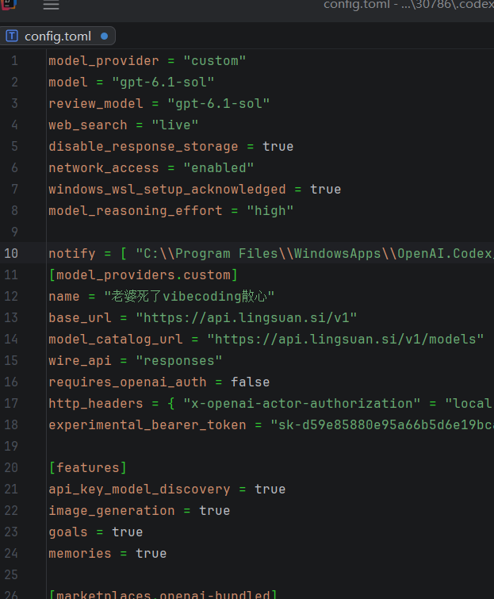

## 流程思路 
是不需要登录codex的（谷歌账号和国外手机号都不需要） 改配置的key登录能绕过登录
需要承担中转站风险（跑路，被封禁，模型参水等），好的中转有售后

## 具体操作（不懂的都可以直接问ai，用trea，workbuddy和qoder等等这些国内的agent直接帮改也行）
中转站登陆后生成key再按流程再powershell改codex cli配置
桌面端的就改codex目录下的config.toml就行

一样的代码，token位置写上中转站生成的key

## 最后推荐个玩具
codex龙娘桌宠 能检测套餐额度和刷新
https://github.com/InhamiRei/Codex-DragonGirl

本站分享的软件及开源项目链接仅供参考，相关权利归原权利人所有。下载、使用及再分发请遵守相关法律和许可协议。如发现侵权内容，请联系【邮3078675260@qq.com】，本站将及时核实并依法处理。