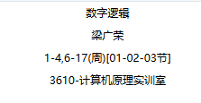

********************************************************************************************************************

EAMS{

JWT

BCrypt加密

接口鉴权 

LambdaQueryWrapper的筛选条件清单功能(动态拼接查询条件)

等等 

记得每次commit都来更新下吧
}

********************************************************************************************************************

SpringCloudAlibaba，Nacos{

没看了 好像没必要专门看

}

********************************************************************************************************************

linux{

CentOS+FinalShell

同上

}

********************************************************************************************************************

python ai{

还是开头

}

********************************************************************************************************************

Langchain{

黑马发了新课，有项目结合有空可以看下

}

********************************************************************************************************************

数据结构{

图

}

********************************************************************************************************************

MySQL{

总结课

黑马的MySQL课程可以看（后续eams项目碰到数据库优化方面的可以结合来看）

}

********************************************************************************************************************

数字逻辑{

记得15周去上课

16 17周差不多期末考应该

}

********************************************************************************************************************

离散数学{

六节课 讲了两新课应该 有个画图

有空补下

期末得注意 数据结构和离散

}
********************************************************************************************************************

杂谈{

蓝桥javaB组明年4月

有29届的已经包装完头条写完Langchain项目准备大二寒假实习了 共勉

gta5补完去玩天国一吧

}
********************************************************************************************************************