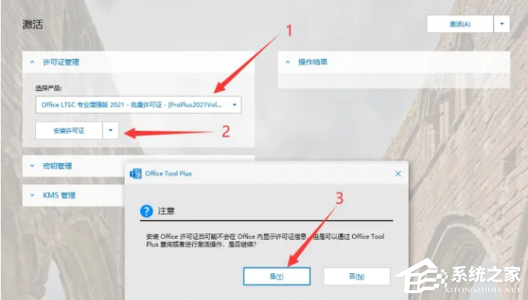
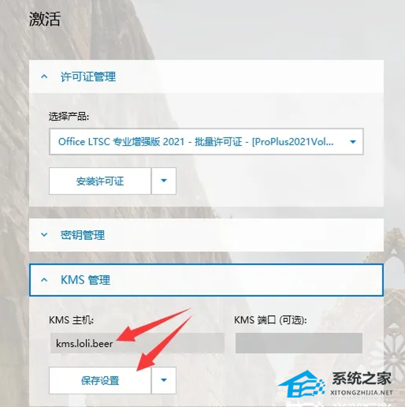
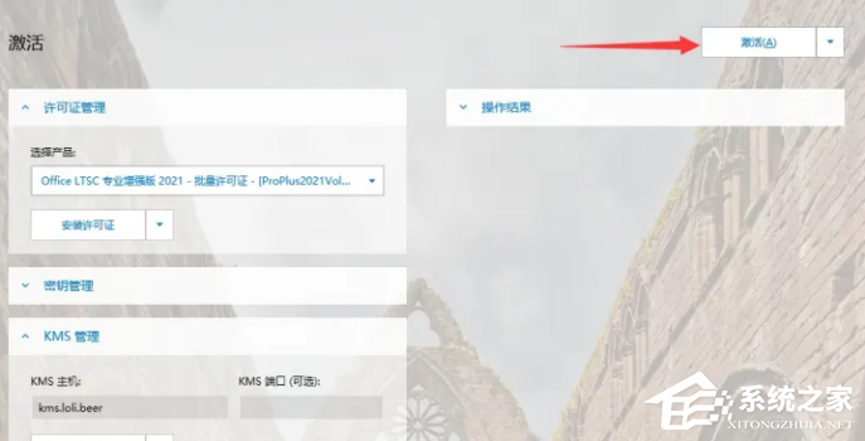
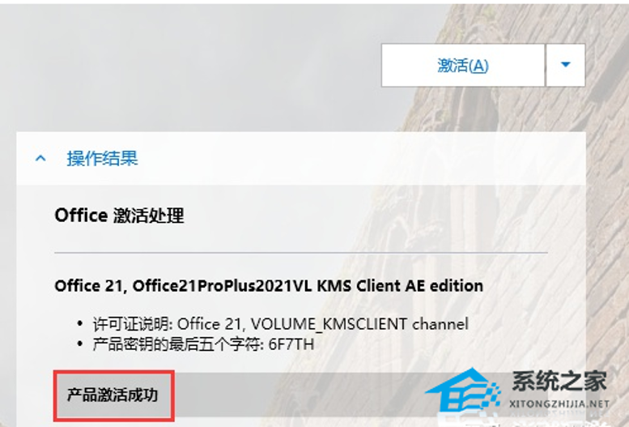

[Office Tool Plus最新版下载_Office Tool Plus官方版免费下载10.0.4.7 - 系统之家](https://www.xitongzhijia.net/soft/214222.html)

1、请优先使用自动激活，避免你遇到问题又不会解决。但如果自动激活不了，还可以尝试下手动激活。
　　   打开Office Tool Plus后，点击“激活”
 
2、选择要激 活的产品（选批量许可的），接着点「安装许可」
 
3、等许可安装好。点开KMS管理，KMS主机地址填写：kms.loli.beer，保存。
 
4、可以点激活了。
 
5、成功。可以去查看下激活状态，应该没什么问题了（第2步选择要激活的产品 一定要选对）
 

本站分享的软件及开源项目链接仅供参考，相关权利归原权利人所有。下载、使用及再分发请遵守相关法律和许可协议。如发现侵权内容，请联系【邮3078675260@qq.com】，本站将及时核实并依法处理。